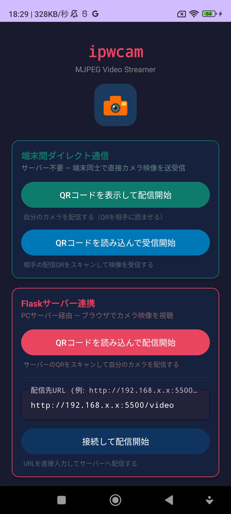
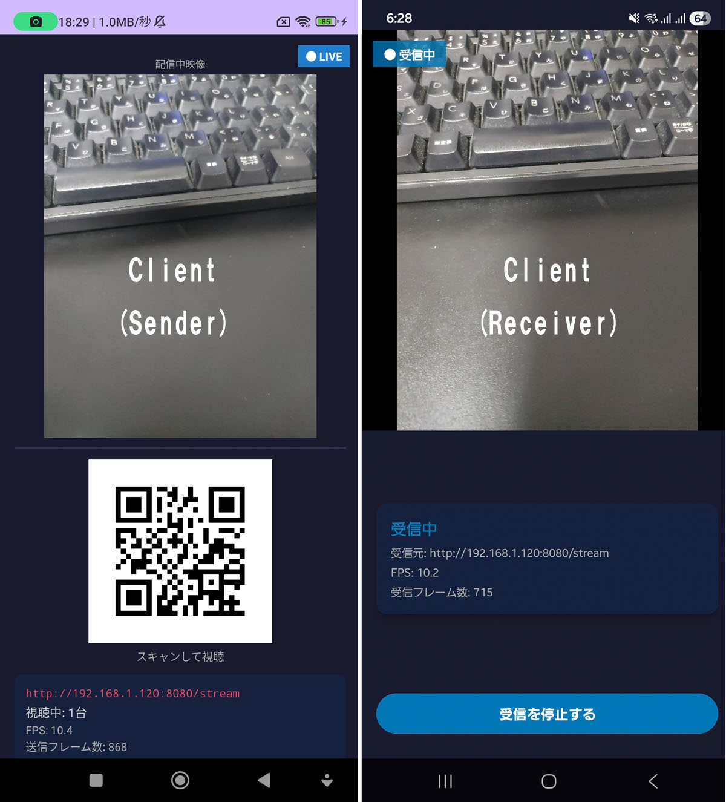
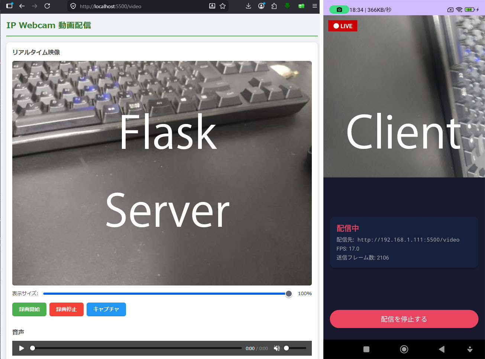

# ipwcam

[English version here](./README.md)

ローカルエリアネットワーク（LAN）上でAndroidデバイスのカメラ映像をリアルタイム配信するシステムの試作品です。サーバー不要で端末間直接通信するモードと、FlaskサーバーをPC上で起動してブラウザで視聴するモードの2種類に対応しています。



*アプリ起動画面 — モードを選んですぐ使えます*

---

## システム概要

### モード1 — 端末間ダイレクト通信（サーバー不要）

```
[配信側 Android] --MJPEG HTTP（組み込みサーバー）--> [受信側 Android]
```

配信側がストリーミングサーバーとして動作し、QRコードを表示します。受信側がそのQRコードをスキャンすることで、PCやサーバーなしで端末間のライブ映像視聴が可能です。



*左：配信側 — QRコードとカメラプレビューを表示。右：受信側 — ライブ映像をアプリ内で受信・表示。*

---

### モード2 — Flaskサーバー経由（ブラウザ視聴）

```
[Androidクライアント] --MJPEG HTTP POST--> [Flaskサーバー] --MJPEG HTTP GET--> [ブラウザ]
```

AndroidアプリがカメラフレームをPC上のFlaskサーバーへPUSH送信し、サーバーが同一ネットワーク上のブラウザへ再配信します。ブラウザからの録画・キャプチャにも対応しています。



*左：FlaskサーバーがライブPCブラウザ上に表示。右：配信中のAndroidアプリ。*

---

## リポジトリ構成

```
ipwcam/
├── client/   # Androidクライアントアプリ (Kotlin)
└── server/   # 受信・配信サーバー (Python / Flask)
```

各フォルダに詳細なREADMEがあります。

- [クライアント詳細](./client/README.md)
- [サーバー詳細](./server/README.md)

---

## 技術スタック

| コンポーネント | 言語・フレームワーク |
|---|---|
| Androidクライアント | Kotlin, CameraX, OkHttp, ML Kit |
| サーバー | Python, Flask, OpenCV |
| フロントエンド | HTML / JavaScript |
| ストリーミング形式 | MJPEG (multipart/x-mixed-replace) |

---

## クイックスタート

### モード1 — 端末間ダイレクト通信

両端末にアプリをインストールするだけで使えます。PCやサーバーのセットアップは不要です。

**配信側の操作：**
1. **「QRコードを表示して配信開始」** をタップ
2. QRコードとカメラプレビューが表示される

**受信側の操作：**
1. **「QRコードを読み込んで受信開始」** をタップ
2. 配信側に表示されたQRコードをスキャン
3. アプリ内にライブ映像が表示される

### モード2 — Flaskサーバー経由

#### 1. サーバーを起動する（PC側）

```bash
cd server
./setup.sh   # 初回のみ
./start.sh   # Flaskサーバー起動 (port 5500)
```

#### 2. Androidアプリをビルド・インストールする

Android StudioでClientプロジェクトを開いてビルドするか、以下を実行します：

```bash
cd client
./gradlew assembleDebug
```

#### 3. Androidアプリから接続する

- **「QRコードを読み込んで配信開始」** をタップ → ブラウザに表示されたQRをスキャン
- または **「接続して配信開始」** をタップ → URLを手動入力して接続

ブラウザで `http://<サーバーのIPアドレス>:5500` を開くとライブ映像を視聴できます。

---

## 動作要件

| 対象 | 要件 |
|---|---|
| Androidデバイス | Android 8.0以上 (API 26+) |
| サーバーOS | Linux / macOS (bash環境) |
| Pythonバージョン | Python 3.x |
| ネットワーク | すべての端末が同一LAN内にいること |

---

## ライセンス

MIT License — 詳細は [LICENSE](./LICENSE) を参照してください。

---

## 間隔配信 / Tailscale対応 / 長時間運用

### 送信間隔（離れた場所の指示計を見守る用途など）

アプリのメイン画面で **送信間隔（秒）** を設定します。`0` = リアルタイム（従来どおり）、`1` = 1秒ごとに1枚、`60` = 1分ごとに1枚。設定は保存され、次のように使われます。

- **Flaskサーバー連携** — アプリが送信間隔をサーバーへ申告します（`X-Capture-Interval-Ms` ヘッダ）。間隔が0より大きいとき、ブラウザ画面は自動でMJPEGストリームから「最新フレームの更新表示」に切り替わり、「最終受信: N秒前」を表示します。受信が途絶えると警告を出します。
- **端末間ダイレクト通信** — 配信側が最新フレームを常に更新しておくので、間隔の途中で接続した受信側にもすぐ画像が表示されます。間隔は配信画面の設定ダイアログからも変更できます。

サーバーに追加したエンドポイント: `GET /latest.jpg`（最新フレームをJPEGで取得）、`GET /status`（受信連番・最終受信時刻・送信間隔のJSON）。

### Tailscale（4G回線・別ネットワーク）

- **Flaskサーバー連携**: サーバーPCでTailscaleが動いていれば、画面に `http://100.x.y.z:5500/video` の2つ目のQRコードを表示します。4G回線の端末（Tailscale導入済み）はこちらを読み取るか、URLを手入力します。
- **端末間ダイレクト通信**: 配信側がLANとTailscaleの両方のアドレスを持つ場合、QRは「LANのURL + `?alt=<TailscaleのIP>`」になり、受信側が到達できる方を自動選択します（受信側自身がTailscaleに接続していればTailscaleを先に試します）。配信側がTailscaleのみ（4G回線など）の場合はそのアドレスを使います。
- サーバー側の検出を上書きする場合は環境変数 `IPWCAM_TAILSCALE_IP` を指定します。

### 長時間運用

配信中は、画面の自動消灯の無効化、CPUウェイクロック、Wi-Fiロックを行い、初回のみ電池最適化の除外を案内します。カメラプレビューをタップすると画面が最低輝度になります（もう一度タップで戻ります）。配信側・受信側とも、接続が切れても自動で再接続します。

注意: スマホを常時充電すると電池が膨らむことがあります。充電上限設定やタイマー付きコンセントの併用をおすすめします。Flaskのデバッグモードは既定でオフになりました（有効化は `IPWCAM_DEBUG=1`）。
